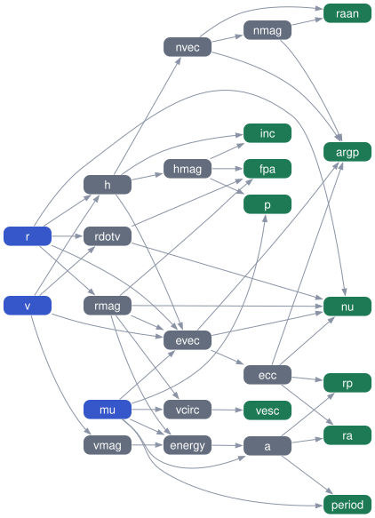

A Fortran function parser and evaluator for expressions involving multiple variables, supporting vectorized operations, user-defined functions, and first derivatives.

### Features

* **Standard modern Fortran.** Object-oriented, with no compiler extensions. Documented with FORD-compatible doc comments. MIT licensed.
* **Expressions of any number of variables**, such as `sin(x) + 2.0*y`. Each expression is parsed once into an internal tree, and you can then evaluate it as many times as you like with new variable values. When all the variables are scalars, a compiled scalar instruction list is used instead, which is several times faster.
* **Systems of named expressions.** You pass a list of expressions and their output names, such as `['sin(x) + 2.0*y', 'z + x']` named `['z', 'w']`. An output can be used in other expressions, and the evaluation order is worked out from the dependencies automatically. Circular dependencies are reported as errors.
* **Scalars and vectors.** A variable can be a scalar or a vector, and operations and functions work element by element as in Fortran (`sin(x)` is a vector if `x` is a vector). Scalars are broadcast. You can build vectors with `[a, b, c]` and index them with `v[i]`.
* **Operators:** arithmetic (`+ - * / ^ **`), relational (`== /= < <= > >=`, plus the Fortran `.eq.`-style forms) and logical (`&& || !`, plus `.and. .or. .not.`).
* **Built-in functions:**
  * one argument (e.g. `sin(x)`, `exp`, `log`, `sqrt`, `abs`, `floor`)
  * two or more arguments (e.g. `max(x,y)`, `atan2`, `mod`, `hypot`)
  * reductions (e.g. `sum`, `norm2`, `maxval`)
  * vector functions (`dot_product(x,y)`, `cross(x,y)`)
* **Conditionals:** `if(value_if_true, value_if_false, condition)`, where any nonzero condition counts as true. Conditionals can be nested and work element by element on vectors. With a scalar condition, only the selected branch is evaluated.
* **User-defined functions** with any number of arguments, declared as pure or impure. You can supply a derivative routine for each one; if you don't, finite differences are used.
* **Optional first derivatives** with respect to any of the input variables, using forward-mode automatic differentiation. Depending on the sizes involved, a derivative is a scalar, a vector or a matrix (Jacobian). Derivatives are computed only when you ask for them, so they don't slow down normal evaluation. Derivatives that the structure of the expressions shows are zero are skipped.
* **Caching:** only the expressions whose inputs have changed since the last evaluation are recomputed. The others keep their previous results.
* **Dependency queries:** find the variables an expression depends on, or the expressions that depend on a variable, directly or through other expressions, or get the full dependency matrix. You can export the dependency graph as Graphviz DOT, JSON (NetworkX/D3 node-link), GraphML or Mermaid.
* **Code generation:** generate a standalone Fortran module that computes the expressions, and optionally their Jacobians, so a model prototyped with fparse can be compiled.
* **Error checking.**
  * At parse time: syntax errors, undefined variables and functions, wrong argument counts, and invalid or duplicate names.
  * At runtime: division by zero, domain errors, size mismatches, out-of-bounds indexes, and unset variables.
  * Errors are returned as status codes with messages, and never stop the program.
* **Case-insensitive names:** `x` and `X` refer to the same variable.
* **Built with fpm** and tested with gfortran, with a comprehensive unit test suite that uses test-drive. You can add it to another project as an fpm dependency.

### Usage

```fortran
use fparse

type(fparser) :: p
real(wp) :: w, dwdx
integer :: status
character(len=:), allocatable :: errmsg

! the order of the expressions does not matter; it is determined from the dependencies
call p%parse(variables   = ['x', 'y'], &
             expressions = [character(len=20) :: 'z + x', 'sin(x) + 2.0*y'], &
             names       = ['w', 'z'], &
             status=status, errmsg=errmsg)
if (status /= 0) error stop errmsg

call p%set_variable('x', 1.0_wp)
call p%set_variable('y', 2.0_wp)          ! a vector can also be given: [1.0_wp, 2.0_wp]
call p%evaluate(wrt=['x'], status=status, errmsg=errmsg)  ! omit `wrt` for no derivatives
call p%get('w', w)                        ! or get a vector: real(wp), allocatable :: v(:)
call p%get_derivative('w', 'x', dwdx)     ! or a matrix:     real(wp), allocatable :: jac(:,:)
```

Every method takes the optional outputs `status` (0 means success) and `errmsg`. You can also call `p%failed()` and `p%error_message()`. Errors never stop the program.

#### Expressions

* The output names are given in the `names=` argument of `parse`, one per expression. Inputs and outputs must all have different names. Alternatively, leave out `names=` and write each expression as `name = expr`. An expression with no name (a blank entry in `names`, or no `name =`) is anonymous: you can only retrieve it by index, e.g. `p%get(1, val)`.
* Operators, from lowest to highest precedence:
  * `||` and `.or.`
  * `&&` and `.and.`
  * `!` and `.not.`
  * `==`, `/=` (or `!=`), `<`, `<=`, `>`, `>=`, and the forms `.eq.`, `.ne.`, `.lt.`, `.le.`, `.gt.`, `.ge.`
  * `+` and `-`
  * `*` and `/`
  * unary `-`
  * `^` and `**` (right associative, so `-x**2` is `-(x**2)`)
* Relational and logical operators return `1.0` (true) or `0.0` (false). Any nonzero value counts as true.
* Vectors: `[a, b, 1]` builds a vector by concatenation, and `v[i]` indexes one (1-based). Scalars are broadcast in element-wise operations.
* The constant `pi` is predefined. A variable named `pi` takes precedence over it.
* Names are case insensitive.

#### Built-in functions

| Kind | Functions |
|---|---|
| one argument, element-wise | `abs sqrt exp log (ln) log10 sin cos tan asin acos atan sinh cosh tanh asinh acosh atanh erf erfc floor ceiling (ceil) nint (anint, round) aint (trunc)`, and in degrees: `sind cosd tand asind acosd atand` |
| two arguments, element-wise | `atan2(y,x) (atan(y,x)) atan2d(y,x) (atand(y,x)) mod(a,p) modulo(a,p) sign(a,b) hypot(x,y)` |
| two or more arguments | `max(a,b,...) min(a,b,...)` |
| reductions (scalar result) | `sum product norm2 (norm) maxval minval size` |
| vector | `dot_product(a,b) (dot)`, `cross(a,b)` |
| conditional | `if(value_if_true, value_if_false, condition)` (alias `merge`, same as Fortran's `merge`) |

When the condition of an `if` is a scalar, only the selected branch is evaluated, so `if(log(x), 0, x > 0)` is safe for `x <= 0`. When the condition is a vector, the selection is element-wise and both branches are evaluated.

#### Runtime errors

Evaluation checks for division by zero, domain errors (`sqrt`/`log` of negative numbers, `asin(2)`, a negative number raised to a non-integer power, and so on), size mismatches, out-of-bounds indexes, and unset variables. To get IEEE Inf/NaN results instead of domain errors, call `p%set_domain_checking(.false.)`.

#### Derivatives

`p%evaluate(wrt=['x','y'])` also computes the first derivatives of every output (and every intermediate output) with respect to the listed input variables, using forward-mode automatic differentiation. For an output of size `m` and a variable of size `n`, the derivative is an `[m, n]` matrix. Without `wrt`, no derivative work is done. The derivatives of piecewise functions (`abs`, `max`, `if`, ...) are those of the active branch.

By default, fparse uses the structure of the expressions to skip derivatives that are known to be zero. It determines which of the `wrt` variables each output can depend on, directly or through other outputs, and only computes those columns of its Jacobian. For large systems where each equation only uses a few variables, this is much faster. In [test/benchmark_sparsity.f90](test/benchmark_sparsity.f90), with Jacobians with respect to 1000 variables, it is 28x faster for 2000 scalar equations and 49x faster for 100 vector equations (release build). The results are identical. Use `p%set_sparsity(.false.)` to turn it off; run `pixi run benchmark-sparsity` to compare.

#### User-defined functions

```fortran
subroutine my_func(args, res, stat)   ! interface: fparse_func
    type(fparse_value), intent(in) :: args(:)       ! args(i)%v is the i-th argument (scalar = size 1)
    real(wp), allocatable, intent(out) :: res(:)
    integer, intent(inout) :: stat                  ! set nonzero to signal an error
    res = args(1)%v**2 + args(2)%v
end subroutine

call p%add_function('f', my_func, is_pure=.true., nargs=2, df=my_dfunc)  ! call before parse; df is optional
```

The optional derivative routine (interface `fparse_dfunc`) returns the Jacobian of the result with respect to `args(iarg)`. If you don't provide one, central finite differences are used. User functions take precedence over built-in functions with the same name.

`is_pure` is required. Set it to `.true.` if the result depends only on the arguments, and `.false.` if the function uses saved state, random numbers, the time, or anything else that can change between calls. Expressions that use an impure function, and the ones that depend on them, are never cached (see below).

#### Caching

`evaluate` only recomputes the expressions whose results may have changed since the last successful evaluation. This is common in optimization, where the objective and its gradient are often requested again at the same point, or where only some of the variables change. An expression keeps its cached result if all of these hold:

* no variable it references has changed. That includes inputs and the outputs of other expressions; values must be exactly the same, including the sign of zero, and a NaN never matches;
* it doesn't call an impure user function;
* the same derivatives are requested, meaning the same `wrt` list, or no derivatives both times. An `evaluate()` without `wrt` after an `evaluate(wrt=...)` at the same point reuses the values and discards the derivatives.

An expression that calls an impure function is recomputed on every `evaluate`, and so is any expression that depends on it. The rest are unaffected. Setting an input to the value it already has doesn't count as a change. The cache is cleared by `parse`, by `add_function`, and by changing the domain-checking, scalar-optimization or sparsity options. To turn it off, use `p%set_caching(.false.)`.

#### Dependencies

You can query the dependencies between the variables after `parse`. A direct dependency is a variable that appears in the expression. With `indirect=.true.`, the variables that those depend on, through other expressions, are included too.

```fortran-free-form
integer, dimension(:), allocatable :: inputs, outputs
logical, dimension(:,:), allocatable :: dep
character(len=:), allocatable :: dot

call p%parse(['x', 'y'], ['x*y   ', 'a + 1 ', 'sin(x)'], names=['a', 'b', 'c'])

call p%get_dependencies('b', inputs, outputs)                  ! inputs = [],    outputs = [1] (a)
call p%get_dependencies('b', inputs, outputs, indirect=.true.) ! inputs = [1,2], outputs = [1]
call p%get_dependents('x', outputs, indirect=.true.)           ! outputs = [1,2,3]: recomputed if x changes
if (p%depends_on('b', 'y', indirect=.true.)) print *, 'b depends on y'
call p%dependency_matrix(dep, indirect=.true.)                 ! dep(i,j): expression i depends on variable j
call p%export_dependencies('dot', dot)                         ! the graph, in the DOT language
```

Inputs are identified by their index in the list of input variables, and outputs by their expression index. `get_dependencies` also accepts an expression index instead of a name, for anonymous expressions. In the dependency matrix, the columns are the inputs followed by the outputs. With `indirect=.true.`, its input columns give the structural sparsity pattern of the Jacobian of the outputs with respect to the inputs.

`export_dependencies` writes the dependency graph in a format that other tools can read. The nodes are the variables, and each edge goes from a variable to an expression that references it.

| Format | Read by |
|---|---|
| `dot` | Graphviz, and most graph tools |
| `json` | NetworkX (`node_link_graph`), D3.js |
| `graphml` | yEd, Gephi, Cytoscape, NetworkX, igraph |
| `mermaid` | Mermaid, and GitHub markdown |

The node identifiers are the variable names, or `#k` for the anonymous output of expression `k`. The JSON and GraphML nodes also have the attributes `kind` (`input` or `output`), `index`, `name`, and, for the outputs, `expression` and `order` (the position in the evaluation order).

[example/dependency_graph.f90](example/dependency_graph.f90) builds the graph below from the dependency queries, using the [fdot](https://github.com/jacobwilliams/fdot) layout library. The equations compute the classical orbital elements from a position and velocity vector. The inputs are the position `r` [km], the velocity `v` [km/s] and the gravitational parameter `mu` [km^3/s^2], and the equations are:

```
rmag   = norm2(r)
vmag   = norm2(v)
rdotv  = dot(r, v)
h      = cross(r, v)
hmag   = norm2(h)
energy = vmag^2/2 - mu/rmag
a      = -mu/(2*energy)
evec   = cross(v, h)/mu - r/rmag
ecc    = norm2(evec)
p      = hmag^2/mu
inc    = acos(h[3]/hmag)
nvec   = cross([0, 0, 1], h)
nmag   = norm2(nvec)
raan   = if(acos(nvec[1]/nmag), 2*pi - acos(nvec[1]/nmag), nvec[2] >= 0)
argp   = if(acos(dot(nvec, evec)/(nmag*ecc)), 2*pi - acos(dot(nvec, evec)/(nmag*ecc)), evec[3] >= 0)
nu     = if(acos(dot(evec, r)/(ecc*rmag)), 2*pi - acos(dot(evec, r)/(ecc*rmag)), rdotv >= 0)
period = 2*pi*sqrt(a^3/mu)
rp     = a*(1 - ecc)
ra     = a*(1 + ecc)
fpa    = atan2(rdotv/rmag, hmag/rmag)
vcirc  = sqrt(mu/rmag)
vesc   = sqrt(2)*vcirc
```

In the graph, the inputs are blue, the intermediate outputs are gray, and the final outputs, which no other expression uses, are green.



#### Code generation

`generate_fortran` writes Fortran source code for the expressions: a module with no dependencies, containing a subroutine that computes the outputs and, if `wrt` is given, one that also computes their Jacobians with respect to those inputs. The derivatives are written out as plain statements (forward mode), and derivatives that are known to be zero are skipped.

```fortran-free-form
character(len=:), allocatable :: code

call p%parse(['x', 'y'], ['sqrt(x^2 + y^2)', 'atan2(y, x)    ', 'if(r, 0, r > 1)'], names=['r    ', 'theta', 'f    '])
call p%set_variables([3.0_wp, 4.0_wp])
call p%generate_fortran(code, module_name='polar', wrt=['x', 'y'])
```

The generated module contains `polar_eval(x, y, r, theta, f)` and `polar_jac(x, y, r, theta, f, d_r, d_theta, d_f)`:

```fortran-free-form
pure subroutine polar_eval(x, y, r, theta, f)
    real(wp), intent(in) :: x
    real(wp), intent(in) :: y
    real(wp), intent(out) :: r
    real(wp), intent(out) :: theta
    real(wp), intent(out) :: f
    real(wp) :: t1

    r = sqrt(x**2 + y**2)
    theta = atan2(y, x)
    if (r > 1.0_wp) then
        t1 = r
    else
        t1 = 0.0_wp
    end if
    f = t1
end subroutine polar_eval
```

* The code is specialized for the sizes of the inputs that are currently set: scalars become `real(wp)` arguments, and vectors become arrays of the same size.
* The arguments are the inputs, then the outputs, then (for the Jacobian routine) the Jacobian of each output, `d_<name>`. The Jacobian of a scalar output is a vector, and that of a vector output is a matrix with one row per element. The columns are the elements of the `wrt` variables, in order. A comment at the top of the module lists all of this.
* Anonymous outputs are named `out<k>`. Names that would clash with Fortran intrinsics or the generated names get an underscore appended (a variable named `sin` becomes `sin_`).
* The results are the same as fparse's, including the behavior of `^`, `if` (only the selected value is computed for a scalar condition), and the relational and logical operators.
* The generated code doesn't check for domain errors (they give NaN or infinity, as in plain Fortran) or that indices are within bounds. User-defined functions aren't supported.

The tests compile the generated code for several systems of expressions, run it, and check that its results match fparse's.

### Building and testing

With [pixi](https://pixi.sh):

```
pixi run build     # fpm build
pixi run test      # fpm test
pixi run example   # run example/example.f90
pixi run dependency-graph # run example/dependency_graph.f90 and update the graph above
pixi run codegen   # run example/codegen.f90 (generate, compile and run Fortran code)
pixi run docs      # FORD documentation in ./doc
pixi run benchmark # run the speed benchmarks and update the table below
pixi run benchmark-sparsity # compare derivatives with sparsity on and off
```

To use fparse in another fpm project:

```toml
[dependencies]
fparse = { git = "https://github.com/jacobwilliams/fparse" }
```

### Benchmarks

These benchmarks compare fparse with hand-written Fortran and with the other Fortran function parsers from [this list](https://github.com/sdm900/fortran_parser) that are available as fpm packages. Each parser is a dev-dependency used only by [test/benchmark.f90](test/benchmark.f90), which also checks every result against native Fortran. For reference, the Python column times the same calculations written by hand in Python ([test/benchmark.py](test/benchmark.py), using numpy for the vector case); it is filled in when Python and numpy are available. `pixi run benchmark` builds with the fpm `release` profile and rewrites the table below. Running `fpm test` does a short version of the same run, with very little timing.

<!-- BENCHMARK_START -->
Time per evaluation (lower is better). In parentheses: time relative to native Fortran (or relative to fparse for the parse benchmark). "—" means not supported, and "wrong result" means the result did not match native Fortran. Among the parsers (not native Fortran or Python), ✅ marks the fastest correct result in each row and ❌ the slowest.

| Case | Native Fortran | Python | fparse | [fortran_function_parser][ffp] | [feq-parse][feq] | [M_calculator][mcalc] |
|---|---:|---:|---:|---:|---:|---:|
| Simple expression | 0.6 ns | 49.7 ns (88x) | 20.8 ns (37x) | 12.4 ns (22x) ✅ | 167.7 ns (296x) | 55.74 µs (98467x) ❌ |
| Trig expression | 4.4 ns | 78.8 ns (18x) | 28.9 ns (6.6x) | 26.1 ns (6.0x) ✅ | 207.1 ns (47x) | 102.59 µs (23486x) ❌ |
| Polynomial | 0.6 ns | 95.1 ns (151x) | 29.9 ns (48x) ✅ | 35.7 ns (57x) | 1.26 µs (2007x) | 148.75 µs (236956x) ❌ |
| Complex expression | 9.9 ns | 266.4 ns (27x) | 90.2 ns (9.1x) ✅ | 160.5 ns (16x) | 2.46 µs (249x) | 396.15 µs (40170x) ❌ |
| 100 equations (time per set) | 204.8 ns | 5.84 µs (29x) | 2.57 µs (13x) ✅ | 4.63 µs (23x) | 108.36 µs (529x) | 10.07 ms (49156x) ❌ |
| Vector, 1000 points (time per set) | 4.14 µs | 7.55 µs (1.8x) | 7.46 µs (1.8x) ✅ | 27.03 µs (6.5x) | 9.63 µs (2.3x) | 109.90 ms (26531x) ❌ |
| Parse complex expression | — | 15.02 µs (2.7x) | 5.47 µs | 105.43 µs (19x) ❌ | 4.84 µs (0.9x) ✅ | — |
| Trig expression + gradient | 12.4 ns | 135.6 ns (11x) | 296.8 ns (24x) ✅ | — | — | — |

Expressions (variables `x`, `y`, `z`):

* Simple: `x + y*z`
* Trig: `sin(x)*cos(y) + exp(-z)`
* Polynomial: `((((3*x + 2)*x - 5)*x + 1)*x - 7)*y + z`
* Complex: `sqrt(x^2 + y^2 + z^2)*exp(-x*y/(1 + z^2)) + log(1 + abs(sin(x)*cos(y))) - tan(z/3)^2 + (x - y)/(x + y + 3)`
* 100 equations: `sin(x + k)*y + z^2/k - x*k` for `k = 1, 2, ..., 100`
* Vector: the trig expression evaluated at 1000 points (fparse, feq-parse and Python (numpy) evaluate the whole array at once; the others loop over the points)
* Gradient: the trig expression and its derivatives with respect to `x`, `y` and `z`
* Python: the same calculations written in Python ([test/benchmark.py](test/benchmark.py)), with the `math` module, and numpy for the vector case. The parse case is `compile()` of the complex expression. As in the native Fortran column, the gradient is computed with hand-written derivatives (fparse computes it using automatic differentiation). Run with Python 3.13.18, numpy 2.5.4.

Generated on 2026-11-07 by `pixi run benchmark` ([test/benchmark.f90](test/benchmark.f90)) using GCC version 16.2.0 with options `-mcpu=apple-m1 -mlittle-endian -mabi=lp64 -O3 -funroll-loops -fcoarray=single`.

[ffp]: https://github.com/jacobwilliams/fortran_function_parser
[feq]: https://github.com/FluidNumerics/feq-parse
[mcalc]: https://github.com/urbanjost/M_calculator
<!-- BENCHMARK_END -->

Notes:

* fparse compiles each expression to a scalar instruction list, which it uses whenever all the variables are scalars, including when gradients are requested. Otherwise it uses a tree evaluator that handles vectors and Jacobians, and whose buffers are reused between evaluations. For very short expressions, its fixed cost per call (setting variables, evaluating and getting results, with error checking) is the main cost.
* feq-parse is pinned to a commit on its `master` branch, because its latest release (v2.2.2) evaluates `a - b + c` as `a - (b + c)` (for example, `1 - 2 + 3` gives `-4`). That bug is fixed on `master` ([#44](https://github.com/FluidNumerics/feq-parse/issues/44)) but not in a release yet.
* M_calculator is an interpreter: it processes the expression string on every evaluation, and it has no separate parse step. Variables are passed through its `x(:)` array.
* Some parsers from the list are left out:
  * [ffp](https://github.com/jacobwilliams/ffp) has an `fpm.toml` but doesn't compile under fpm, because it relies on implicit typing.
  * The others ([fortran_parser](https://github.com/sdm900/fortran_parser), [FortranParser](https://github.com/jacopo-chevallard/FortranParser), [Fortran-Expression-Evaluator](https://github.com/ivomarsoares-personal/Fortran-Expression-Evaluator), [calmat](https://github.com/hassaniriad/calmat)) aren't fpm packages.


